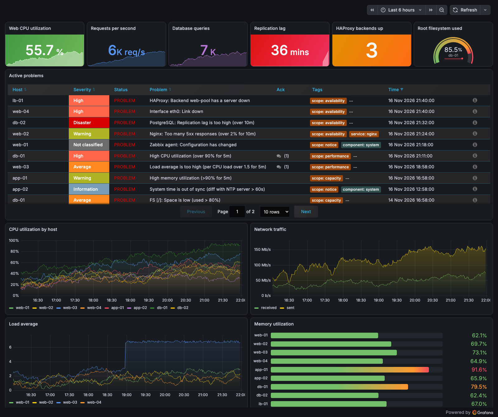
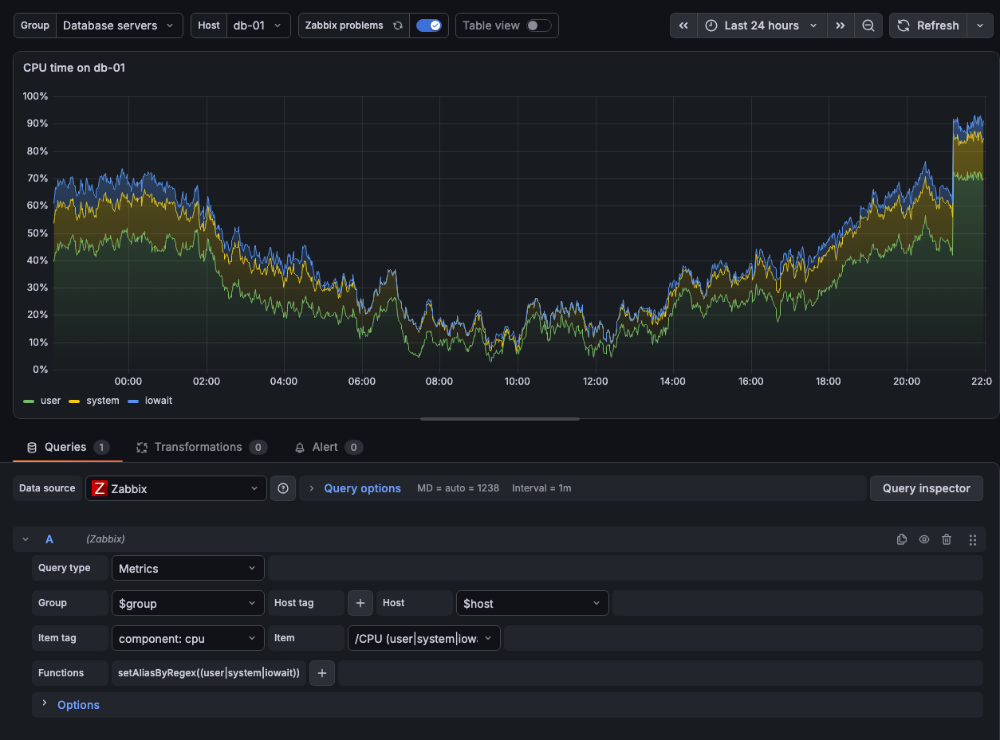

# Zabbix plugin for Grafana

[](https://github.com/grafana/grafana-zabbix/releases)
[](https://github.com/grafana/grafana-zabbix/blob/main/CHANGELOG.md)
[](https://grafana.com/docs/plugins/alexanderzobnin-zabbix-app/latest/)

Visualize and alert on your Zabbix monitoring data in Grafana. Query metrics, follow active problems, annotate graphs with Zabbix events, and build reusable dashboards with template variables. For wide time ranges, the plugin can also read history directly from the Zabbix database.



## Features

- Select multiple items across hosts and groups [with regular expressions and tag filters](https://grafana.com/docs/plugins/alexanderzobnin-zabbix-app/latest/query-editor/)
- Build interactive, reusable dashboards with [template variables](https://grafana.com/docs/plugins/alexanderzobnin-zabbix-app/latest/template-variables/)
- Monitor active problems and triggers with the Problems panel
- Show Zabbix events on graphs with [annotations](https://grafana.com/docs/plugins/alexanderzobnin-zabbix-app/latest/annotations/)
- Transform and aggregate data with [metric processing functions](https://grafana.com/docs/plugins/alexanderzobnin-zabbix-app/latest/functions/) such as `groupBy`, `scale`, `rate`, `movingAverage`, `percentile`, and `setAlias`
- Create [Grafana alert rules](https://grafana.com/docs/plugins/alexanderzobnin-zabbix-app/latest/alerting/) from Zabbix data
- Query history from MySQL, PostgreSQL, InfluxDB, or ClickHouse with [Direct DB Connection](https://grafana.com/docs/plugins/alexanderzobnin-zabbix-app/latest/configure/#configure-direct-db-connection) for faster queries over long time ranges
- Respect Zabbix permissions with per-user authentication, so each Grafana user sees only what their Zabbix role allows
- Mix Zabbix with other data sources in the same dashboard or panel

## Requirements

- Grafana 11.6.0 or later
- A Zabbix server with API access, and a Zabbix user with read permissions for the host groups you want to query

## Installation

Install the plugin from **Administration** > **Plugins and data** > **Plugins** in Grafana, or with the Grafana CLI. On older Grafana versions that ship the standalone binary, use `grafana-cli` instead:

```sh
grafana cli plugins install alexanderzobnin-zabbix-app
```

Zabbix is an app plugin: after installing it, enable it on its plugin page so the Zabbix data source becomes available. For other installation and upgrade options, refer to [Install the plugin](https://grafana.com/docs/plugins/alexanderzobnin-zabbix-app/latest/#install-the-plugin).

## Getting started

1. [Configure the Zabbix data source](https://grafana.com/docs/plugins/alexanderzobnin-zabbix-app/latest/configure/) with your Zabbix API URL and credentials.
1. Build your first panel with the [query editor](https://grafana.com/docs/plugins/alexanderzobnin-zabbix-app/latest/query-editor/).
1. Make it reusable with [template variables](https://grafana.com/docs/plugins/alexanderzobnin-zabbix-app/latest/template-variables/), or import one of the pre-built dashboards from the data source's **Dashboards** tab.



## Documentation

- [Overview and installation](https://grafana.com/docs/plugins/alexanderzobnin-zabbix-app/latest/)
- [Configure the data source](https://grafana.com/docs/plugins/alexanderzobnin-zabbix-app/latest/configure/)
- [Query editor](https://grafana.com/docs/plugins/alexanderzobnin-zabbix-app/latest/query-editor/)
- [Metric processing functions](https://grafana.com/docs/plugins/alexanderzobnin-zabbix-app/latest/functions/)
- [Template variables](https://grafana.com/docs/plugins/alexanderzobnin-zabbix-app/latest/template-variables/)
- [Annotations](https://grafana.com/docs/plugins/alexanderzobnin-zabbix-app/latest/annotations/)
- [Alerting](https://grafana.com/docs/plugins/alexanderzobnin-zabbix-app/latest/alerting/)
- [Troubleshooting](https://grafana.com/docs/plugins/alexanderzobnin-zabbix-app/latest/troubleshooting/)

## Community resources, feedback, and support

- Found a bug or want a new feature? [Open an issue](https://github.com/grafana/grafana-zabbix/issues/new).
- Have a question? Ask on the [Grafana Community](https://community.grafana.com/) forum.
- Find more dashboards for Zabbix in the [Grafana dashboards library](https://grafana.com/grafana/dashboards/?dataSource=alexanderzobnin-zabbix-datasource).
